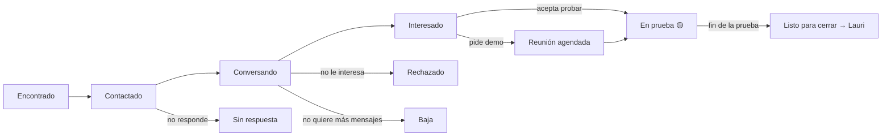
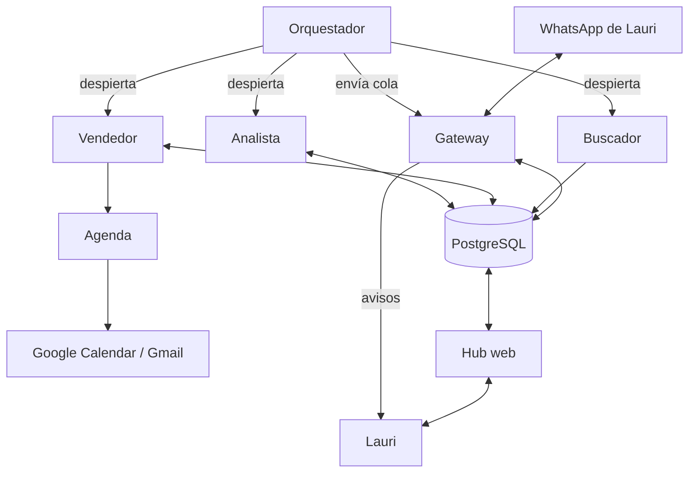
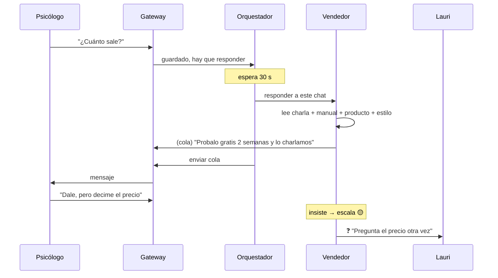

# seller-psicologos: agentes y estructura del negocio

> Documento de contexto para personas y agentes. Tiene dos partes:
> - **Parte 1: los agentes.** Qué es cada uno, para qué existe y qué hace, con todo el detalle.
> - **Parte 2: la estructura general.** El negocio, el embudo, cómo se conectan las piezas, las reglas, los pendientes y las sugerencias.
>
> El producto que se vende está descrito en [`Business_crm.md`](Business_crm.md). La instalación está en [`README.md`](README.md) y [`CONFIGURACION.md`](CONFIGURACION.md).
>
> Estado al 2026-11-07. Cada punto está marcado como ✅ **implementado** (existe en el código) o 🟡 **decidido, falta implementar**.

---

## Resumen en una frase

Un equipo de agentes que trabaja 24/7 para conseguir clientes de **PsycoPy**: busca psicólogos en Argentina, les escribe por WhatsApp como si fuera Lauri, los convence de **probar PsycoPy gratis** y le pasa el chat a Lauri cuando llega el momento de cobrar.

## Mapa del equipo

| Pieza | Tipo | Idea en una línea |
|---|---|---|
| **Buscador** | Agente con IA | Busca psicólogos en la web con un navegador y anota nombre, celular y email. |
| **Vendedor** | Agente con IA | Conversa con ellos por WhatsApp hasta que empiezan la prueba gratis. |
| **Agenda** | Herramienta del Vendedor | Agenda demos en el calendario de Lauri. |
| **Analista** | Agente con IA | Estudia los resultados y propone cómo vender mejor. |
| **Orquestador** | Supervisor sin IA | Marca el ritmo: decide quién trabaja y cuándo, y vigila que todo ande. |
| **Gateway de WhatsApp** | Portero sin IA | La única puerta de entrada y salida de WhatsApp. |
| **Lauri** | Humano | Responde lo que los agentes no saben, cierra las ventas y aprueba las mejoras. |

---

# PARTE 1: LOS AGENTES

Todas las fichas siguen el mismo esquema: **idea → función → cuándo actúa → qué recibe → qué entrega → con quién se comunica → qué decide → qué NO puede hacer → estado**.

---

## 1. Agente Buscador

**Código:** `src/agents/buscador/` · **Modelo:** `LLM_BUSCADOR` · **Guía para modificarlo:** [`src/agents/buscador/README.md`](src/agents/buscador/README.md)

### Idea
Es el que **llena el embudo**, y lo hace con **volumen**. Busca en la web como lo haría una persona: abre un navegador, escribe "psicólogo en {ciudad}", entra a los listados y a las webs que aparecen y anota **nombre, celular y email**. Nada más. Si el psicólogo es buen cliente se averigua después, en la charla con el Vendedor.

### Función
1. **Buscar** con un Chromium sin pantalla (perfil propio, nunca el Chrome de Lauri) en **Bing**. Google y DuckDuckGo quedan de respaldo, porque piden CAPTCHA al navegador automatizado. Recorre ciudad por ciudad (`cities.ts`) las consultas de `content/buscador-consultas.md`.
2. **Abrir** solo los resultados orgánicos. Saltea redes sociales (LinkedIn, Facebook, Instagram, X, TikTok, YouTube) y lo que prohíbe el `robots.txt` del sitio.
3. **Extraer:** si la página tiene algún teléfono, la IA saca la lista de psicólogos con nombre, celular y email, siguiendo `content/buscador-instrucciones.md`. Un celular que no aparece textual en la página se descarta.
4. **Filtrar**, en este orden, y descartar al que:
   - por el nombre es un centro, instituto, equipo, fundación, clínica o asociación,
   - no tiene teléfono válido,
   - ya está en la base (mismo número = misma persona),
   - pidió la baja alguna vez,
   - está inscripto en el **Registro No Llame** (Ley 26.951),
   - no tiene WhatsApp.
5. **Guardar** la ficha mínima, con el link exacto de dónde salió el dato.

Google Places sigue como fuente extra solo si hay `GOOGLE_PLACES_KEY`.

### Cuándo actúa
Una vez por día, desde las **9:00** (`SEARCH_HOUR`). Lo despierta el Orquestador y corre **en segundo plano** (puede tardar más de una hora por las pausas), sin frenar las respuestas del Vendedor. Para forzar una corrida hoy: `docker compose exec worker npm run buscador`.

### Qué recibe
- Las páginas de resultados y las páginas de psicólogos que abre el navegador.
- Las consultas y las instrucciones de `content/`.
- La lista del Registro No Llame (`data/no_llame.csv`) y la lista de bajas.

### Qué entrega
- Prospectos nuevos en estado **`encontrado`** con: nombre, WhatsApp, email (si hay), ciudad, fuente (`bing` / `google` / `duckduckgo` / `google_places`) y **link de la página** donde apareció (para responder "¿de dónde sacaste mi número?").
- Un informe de la corrida (`buscador_run`): encontrados, guardados, motivos de descarte, búsquedas, páginas, consultas a WhatsApp, motor usado, si hubo CAPTCHA y por qué terminó.

### Con quién se comunica
- **Orquestador:** lo despierta y lo frena al apagar el sistema.
- **Gateway de WhatsApp:** le pregunta si un número tiene WhatsApp.
- **Lauri:** le avisa por WhatsApp si un buscador le pidió CAPTCHA (una vez por corrida).
- **Vendedor:** indirectamente, porque le deja las fichas en la base.

### Qué decide
Qué resultados abrir y quién de cada página es un psicólogo con celular.

### Qué NO puede hacer
- Escribirle a nadie.
- Guardar a alguien sin chequear el Registro No Llame. **Si falta el archivo, no guarda a nadie.**
- Inventar datos: nombre, celular y email salen textuales de la página.
- Resolver o esquivar CAPTCHAs, entrar a páginas con login o completar formularios.
- Usar LinkedIn o redes sociales.
- Pasarse de los topes: **50 prospectos** (`BUSCADOR_MAX_PER_DAY`), 25 búsquedas y 150 páginas por corrida, y **150 consultas a WhatsApp por día** (con una pausa de 2 a 6 s antes de cada una; un número sin WhatsApp no se vuelve a consultar en 60 días). Todos los topes se configuran en `.env`.

### Estado
✅ Implementado (navegador, Bing con respaldo, ficha mínima, segundo plano).
Pendiente: probar una corrida completa en el servidor con Docker, WhatsApp e IA reales.

---

## 2. Agente Vendedor

**Código:** `src/agents/vendedor/` · **Modelo:** `LLM_VENDEDOR`

### Idea
Es **Lauri en piloto automático**. Escribe con su estilo, desde su WhatsApp, y su trabajo es uno solo: **que el psicólogo empiece a usar PsycoPy gratis**. No vende a la fuerza ni cobra. Abre la puerta, acompaña la prueba y le entrega el cliente a Lauri para que cierre.

### Función
Tiene seis tareas:

**a) Abrir la conversación** ✅
Toma un prospecto `encontrado`, elige el mensaje de apertura (si hay una prueba A/B, reparte en partes iguales entre las dos versiones), lo adapta a la persona con la ficha y lo manda. → `contactado`.

**b) Conversar** ✅
Cada vez que el psicólogo escribe, lee **toda la charla** junto con el manual de ventas, la ficha del producto, el estilo de Lauri, las preguntas frecuentes y la ficha del prospecto. Con todo eso decide **una acción**:

| Acción | Qué pasa |
|---|---|
| `responder` | Manda un mensaje corto. → `conversando` |
| `escalar_pregunta` | Contesta algo neutral ("lo chequeo y te digo") y le pregunta a Lauri. |
| `ofrecer_reunion` | Usa la Agenda y propone 3 horarios. → `interesado` |
| `agendar_reunion` | Confirma horario y email, crea el evento y manda el mail. → `reunion_agendada` |
| `enviar_prueba` 🟡 | Manda el link de registro de PsycoPy. → `en_prueba` |
| `listo_para_cerrar` | Traspasa a Lauri y no escribe más. |
| `sospecha_bot` | Traspasa a Lauri y no escribe más. |
| `rechazo` | Cierra el contacto. → `rechazado` |
| `baja` | Borra los datos personales y bloquea el número para siempre. → `baja` |

En cada respuesta además **evalúa la charla** (iniciando / interesado / dudando / convencido / frío, más un resumen) y **anota las objeciones** que aparecieron. Las dos cosas las usan el hub y el Analista.

**c) Llevar a la prueba gratis** 🟡
Cuando el psicólogo acepta probar, le manda **https://psicopy.vercel.app/signup**. Si pregunta el precio, **no lo dice** y propone la prueba: "probalo una o dos semanas gratis y después lo charlamos". Si insiste una segunda vez, le pasa la pregunta a Lauri.

**d) Hacer seguimiento** ✅ + 🟡
- ✅ Si no respondió el primer mensaje: **un** seguimiento breve a los 3 días. Si sigue sin responder 4 días después, → `sin_respuesta`.
- 🟡 Durante la prueba: **un solo** mensaje tranquilo **7 días** después de mandar el link ("¿cómo venís con PsycoPy?"). Si no contesta, no insiste.

**e) Traspasar a Lauri** ✅ + 🟡
- ✅ Hoy traspasa cuando el psicólogo quiere comprar, con un aviso de una línea.
- 🟡 Pasa a traspasar **al terminar la prueba** (14 días por defecto) con un **resumen completo**: quién es, cómo trabaja, qué le interesó, objeciones, qué se le dijo (y qué no, por ejemplo el precio) y qué falta resolver.
- Desde el traspaso, **nunca más** escribe en ese chat.

**f) Transmitir las respuestas de Lauri** ✅
Cuando Lauri contesta una escalación en el hub, el Vendedor la reescribe con el estilo de Lauri y se la manda al psicólogo. Además **guarda pregunta y respuesta como FAQ**, así la próxima vez ya sabe contestar sin molestar a Lauri.

### Cuándo actúa
- **Abrir:** hasta 5 por día, con 30 minutos de separación como mínimo, de lunes a viernes de 9 a 20 h.
- **Conversar:** 30 segundos después del último mensaje del psicólogo (espera por si manda varios seguidos), siempre dentro del horario.
- **Seguimientos:** una vez por día, desde las 10:00.
- **Respuestas de Lauri:** apenas Lauri responde en el hub.

### Qué recibe
- La ficha del prospecto (del Buscador) y el historial del chat (del Gateway).
- El conocimiento escrito por Lauri en `content/`:

  | Archivo | Para qué | Estado |
  |---|---|---|
  | `producto-crm.md` | **Lo único** que puede afirmar sobre PsycoPy. | Plantilla, falta completarlo |
  | `manual-ventas.md` | Cómo abordar, qué preguntar, cómo manejar objeciones. | Plantilla |
  | `estilo.md` | Cómo escribe Lauri, con ejemplos. | Plantilla |
  | `apertura.md` | El primer mensaje. | Borrador |
- Las FAQ aprendidas y los horarios libres que le da la Agenda.

### Qué entrega
- Mensajes para el psicólogo (siempre a la cola de salida, nunca directo).
- Cambios de estado del prospecto, evaluación y objeciones.
- Escalaciones y avisos para Lauri.

### Con quién se comunica
- **Orquestador:** lo despierta.
- **Gateway:** le deja los mensajes en la cola para enviar.
- **Agenda:** le pide horarios y le encarga crear reuniones.
- **Lauri:** le escala preguntas y le traspasa clientes.
- **Analista:** indirectamente, porque sus evaluaciones y objeciones son la materia prima del análisis.

### Qué decide
Qué contestar, cuándo proponer una demo, cuándo mandar la prueba, cuándo algo excede lo que sabe y cuándo una charla terminó.

### Qué NO puede hacer
- **Decir el precio** ($75.000 por mes es un dato interno).
- Inventar precios, funciones o promesas que no estén en `producto-crm.md` o en las FAQ.
- Presionar o insistir después de un "no".
- Escribir en un chat traspasado a Lauri, o en uno donde Lauri escribió a mano.
- Escribir fuera de horario.
- Seguir conversando si le preguntan si es un bot.
- Escuchar audios ni ver imágenes: esos casos se los pasa a Lauri.
- Cobrar o cerrar la venta.

### Estado
✅ Abrir, conversar, demo, seguimiento inicial, escalaciones, FAQ y traspaso básico.
🟡 Objetivo "prueba gratis", acción `enviar_prueba`, estado `en_prueba`, política de precio, check-in del día 7, traspaso al terminar la prueba y resumen completo.

---

## 3. Agenda (herramienta del Vendedor)

**Código:** `src/agents/agenda/` · **Sin IA**

### Idea
Es **la secretaria** del Vendedor. No es un agente porque no decide nada: hace exactamente lo que le piden. En el hub se muestra como una función aparte.

### Función
1. **Proponer horarios:** lee el Google Calendar de Lauri y devuelve 3 huecos libres, uno por día hábil, dentro de `MEETING_WINDOW` (lunes a viernes de 10 a 18 h, reuniones de 30 minutos).
2. **Agendar:** crea el evento con **link de Google Meet** e invita al psicólogo.
3. **Confirmar:** manda un mail de confirmación **desde el Gmail de Lauri**.

### Cuándo actúa
Solo cuando el Vendedor decide `ofrecer_reunion` o `agendar_reunion`. Y la reunión es **opcional**: solo se ofrece si el psicólogo la pide.

### Qué recibe
El pedido del Vendedor: el horario elegido (que tiene que ser uno de los ofrecidos) y el email del psicólogo.

### Qué entrega
La lista de horarios libres, el evento creado (id y link de Meet), la reunión registrada en la base y un aviso 📅 para Lauri.

### Con quién se comunica
Con el **Vendedor** y con Google Calendar y Gmail.

### Qué NO puede hacer
- Agendar un horario que no se ofreció, o sin un email válido.
- Funcionar sin las credenciales de Google. En ese caso el Vendedor escala a Lauri.

### Estado
✅ Implementado.

---

## 4. Agente Analista

**Código:** `src/learning/` · **Modelo:** `LLM_ANALISTA`

### Idea
Es **el entrenador** del equipo. Mira los resultados con calma, una vez por semana, y propone cómo mejorar. **No toca nada por su cuenta:** todo lo que propone lo aprueba o lo rechaza Lauri.

### Función
1. **Arbitrar el A/B de aperturas:** compara la apertura **activa** contra la **candidata** según cuántos responden.
   - Si hay menos de 30 contactos por variante (`AB_MIN_PER_VARIANT`), no concluye nada: informa una "tendencia sin confirmar".
   - Si la candidata gana con certeza estadística (p < 0,05), **propone** promoverla.
   - Si la candidata pierde, la retira.
2. **Proponer una apertura nueva:** si no hay ninguna en prueba y se acumularon 30 contactos nuevos, escribe una variante nueva basada en las estadísticas y en las objeciones más frecuentes.
3. **Proponer mejoras al manual:** si en los últimos 30 días hubo al menos 30 contactos con objeciones, reescribe el manual de ventas para responderlas mejor.

### Cuándo actúa
Los **lunes**, desde las 8:00, una vez por semana. Lo despierta el Orquestador.

### Qué recibe
Las estadísticas de cada apertura (contactados, respondieron, avanzaron), las objeciones acumuladas por el Vendedor, el manual actual y el estilo de Lauri.

### Qué entrega
**Propuestas** en `/mejoras`, cada una con un resumen, la evidencia y el contenido nuevo. Si Lauri aprueba, el cambio se aplica y el manual queda **versionado** (se puede volver atrás).

### Con quién se comunica
- **Orquestador:** lo despierta.
- **Lauri:** le presenta las propuestas en el hub.
- **Vendedor:** indirectamente. Usa sus datos, y lo que Lauri aprueba cambia cómo escribe el Vendedor.

### Qué NO puede hacer
- Cambiar el manual o las aperturas sin la aprobación de Lauri.
- Sacar conclusiones con muestras chicas.
- Tener más de una propuesta pendiente del mismo tipo a la vez.

### Estado
✅ Implementado.
Ojo: con aproximadamente 110 contactos en el primer mes, apenas va a alcanzar para una comparación (ver Parte 2, §6).

---

## 5. Orquestador (supervisor)

**Código:** `src/orchestrator/` · **Sin IA**

### Idea
Es **el jefe de turno**. No vende ni busca: decide **quién trabaja y cuándo**, respeta los límites y avisa si algo se rompe. Es deliberadamente simple y sin IA, para que sea predecible.

### Función
Cada **60 segundos** hace una ronda ("tick") con estos pasos, en orden:

| Paso | Qué hace |
|---|---|
| `recuperar` | Después de un reinicio, encuentra mensajes que quedaron sin responder. |
| `responder` | Despierta al Vendedor para los chats que esperaron sus 30 segundos. Fuera de horario, los pasa al inicio de la próxima ventana. |
| `buscador` | Despierta al Buscador una vez por día. |
| `freno` | Si hubo **3 bajas en 7 días**, **pausa los contactos nuevos** y avisa a Lauri. |
| `nuevos_contactos` | Pide al Vendedor que abra un chat nuevo si: está en horario, no hay pausa, hoy van menos de 5 y pasaron 30 minutos desde el anterior. |
| `seguimientos` | Despierta los seguimientos del Vendedor una vez por día. |
| `reintentos` | Reintenta las respuestas que fallaron (por ejemplo, si ningún modelo de IA estaba disponible). |
| `analisis` | Despierta al Analista los lunes. |
| `wa_estado` | Registra si WhatsApp está desconectado hace más de 10 minutos. |
| `outbox` | Le pide al Gateway que envíe lo que está en la cola. |

### Cuándo actúa
Todo el tiempo, una ronda por minuto. También recibe cada mensaje entrante (vía el Gateway) para programar la respuesta.

### Qué recibe
Mensajes entrantes y estado de la conexión de WhatsApp (del Gateway) y el estado guardado en la base (contadores, pausas, última corrida de cada tarea).

### Qué entrega
Órdenes de trabajo para Buscador, Vendedor, Analista y Gateway, pausas de seguridad y avisos a Lauri.

### Con quién se comunica
Con **todos**. Es el único que despierta a los demás.

### Qué NO puede hacer
- Hablar con prospectos.
- Saltarse el límite de 5 contactos nuevos por día, la separación de 30 minutos o el horario.
- Quitar la pausa por bajas por su cuenta (la revisa Lauri).

### Alertas que dispara
- ⛔ Pausa por bajas.
- ⚠️ "El paso X falló 3 veces seguidas".
- WhatsApp desconectado (se ve en el hub, con QR para revincular).

### Estado
✅ Implementado.
🟡 Va a tener que disparar el traspaso a Lauri al terminar cada prueba (o delegarlo en el seguimiento del Vendedor).

---

## 6. Gateway de WhatsApp (portero)

**Código:** `src/whatsapp/` · **Sin IA**

### Idea
Es **la única puerta** entre los agentes y el WhatsApp personal de Lauri. Existe para que **ningún agente pueda tocar un chat que no le corresponde**, y eso está garantizado por el código, no por una instrucción a la IA.

### Función
1. **Lista blanca:** solo deja pasar mensajes de números que son prospectos. Familia, amigos y grupos se ignoran por completo.
2. **Registrar** cada mensaje entrante y saliente en el historial.
3. **Detectar traspasos automáticos:**
   - Si Lauri escribe a mano en un chat de prospecto, ese chat pasa a ser de Lauri.
   - Si alguien de la lista escribe **antes** de que el sistema le haya escrito, es una relación previa de Lauri y no se toca.
4. **Audios, imágenes, videos y documentos:** como el agente no puede verlos, se los pasa a Lauri sin llamar a la IA.
5. **Enviar** lo que está en la cola de salida, con hasta 5 reintentos. **Antes de cada envío vuelve a chequear** que el chat no esté traspasado ni cerrado, que la persona no haya pedido la baja y que sea horario permitido.
6. **Avisar a Lauri** en su chat "Mensaje a mí mismo".

### Cuándo actúa
Siempre que llega un mensaje, y en cada ronda del Orquestador para enviar.

### Qué recibe
Mensajes de WhatsApp (vía Baileys) y la cola de salida.

### Qué entrega
Historial actualizado, aviso al Orquestador de que hay que responder, mensajes enviados y avisos a Lauri.

### Con quién se comunica
Con **WhatsApp**, el **Orquestador**, el **Vendedor** (le recibe los mensajes por la cola), el **Buscador** (le responde si un número tiene WhatsApp) y **Lauri**.

### Qué NO puede hacer
- Leer o escribir en chats que no son de prospectos.
- Enviar sin conexión: los mensajes esperan en la cola.
- Reenviar un mensaje ya enviado.

### Estado
✅ Implementado.

---

# PARTE 2: ESTRUCTURA GENERAL DEL SISTEMA Y DEL NEGOCIO

## 1. El negocio

| | |
|---|---|
| Qué es este sistema | Una **herramienta interna** de un solo usuario (Lauri) para conseguir clientes de PsycoPy. **No es un producto a la venta.** |
| Producto que se vende | **PsycoPy**: CRM para un psicólogo independiente en Argentina (pacientes, agenda, cobros con obras sociales, notas clínicas cifradas). |
| Cliente | Psicólogo/a independiente, con consultorio propio, presencial u online. Los consultorios con varios profesionales quedan para más adelante. |
| Precio | **$75.000 ARS por mes.** Dato interno: los agentes no lo dicen. |
| Oferta de entrada | **Prueba gratis de 1 a 2 semanas** (14 días por defecto), con registro self-service. |
| Meta | **5 psicólogos desconocidos que paguen en 30 días.** Si no se llega, se corta el proyecto. |
| Quién cierra | **Lauri.** A futuro, quizás el agente. |

## 2. El embudo

| # | Etapa | Responsable |
|---|---|---|
| 1 | Encontrar | Buscador |
| 2 | Abrir la conversación | Vendedor |
| 3 | Seguimiento si no responde (1 vez) | Vendedor |
| 4 | Conversar | Vendedor (+ Lauri si escala) |
| 5 | Demo, si la pide | Vendedor + Agenda |
| 6 | Mandar el link de prueba 🟡 | Vendedor |
| 7 | Check-in al día 7 🟡 | Vendedor |
| 8 | Traspaso al terminar la prueba 🟡 | Vendedor → Lauri |
| 9 | Cerrar y cobrar | **Lauri** |

**Atajo:** si alguien quiere pagar antes de probar, se traspasa directo a Lauri.

## 3. Cómo se comunican las piezas

**Los agentes no se hablan entre sí. Todo pasa por la base de datos PostgreSQL**, que funciona como tablero compartido y cola de trabajo. El Orquestador decide a quién despertar.

| Tabla | Escribe | Lee | Para qué |
|---|---|---|---|
| `prospects` | Buscador, Vendedor, Gateway | Todos, hub | Ficha y **estado** de cada psicólogo. |
| `messages` | Gateway | Vendedor, hub, Analista | Historial de cada chat. |
| `outbox` | Vendedor, Orquestador | Gateway | **Cola de salida.** Nada se envía directo. |
| `escalations` | Vendedor, Gateway | Hub, Vendedor | Preguntas para Lauri y sus respuestas. |
| `faq` | Vendedor | Vendedor | Respuestas de Lauri reutilizables. |
| `opt_outs` | Vendedor | Buscador, Gateway | Números bloqueados para siempre. |
| `opener_variants`, `manual_versions`, `proposals` | Analista, hub | Vendedor, hub | Mejoras y versiones. |
| `meetings` | Agenda | Hub | Reuniones agendadas. |
| `events` | Todos | Hub | Bitácora de actividad y errores. |
| `kv` | Orquestador | Orquestador, hub | Estado interno (pausas, cursores, conexión). |

### Ejemplo: un psicólogo pregunta el precio

## 4. El rol de Lauri y el hub

Lauri **supervisa, no opera**. Hace cuatro cosas:
1. Responde las escalaciones (cada respuesta queda como FAQ).
2. Cierra las ventas que le traspasan.
3. Aprueba o rechaza las mejoras del Analista.
4. Mantiene actualizado `content/`.

Se entera de todo por dos canales: el **hub** y su **WhatsApp ("Mensaje a mí mismo")**.
Avisos: ❓ pregunta · ✅ listo para cerrar · ⚠️ sospecha de bot · 📅 reunión · ⛔ pausa por bajas · ⚠️ falla repetida.

| Pantalla del hub | Qué muestra |
|---|---|
| `/` | Métricas, prospectos ordenados por urgencia y avisos. |
| `/p/:id` | Chat completo, ficha, evaluación del agente y respuesta a escalaciones. |
| `/pipeline` | El embudo y el movimiento entre estados. |
| `/mejoras` | Propuestas del Analista para aprobar o rechazar. |
| `/sistema` | Conexión de WhatsApp (QR), cola de salida y errores. |

## 5. Reglas que no se rompen

**Negocio:** no decir el precio · no inventar · no presionar · un chat traspasado nunca vuelve al agente · nada cambia sin la aprobación de Lauri.
**Legales:** Registro No Llame (Ley 26.951) antes de guardar a nadie · baja = datos borrados y número bloqueado (Ley 25.326) · inscribir la base ante la AAIP (pendiente de Lauri).
**WhatsApp personal:** el riesgo de bloqueo lo asume Lauri. Se mitiga con 5 contactos nuevos por día espaciados, horario laboral, freno por bajas y lista blanca.

**IA:** los modelos son gratuitos por ahora (Gemini y Groq), con respaldo en cadena por agente. Para pasar a modelos pagos se edita `.env`, sin tocar código. Si fallan todos, la respuesta espera; nunca se manda un mensaje roto.

**Infraestructura:** Docker Compose en un servidor Linux con `db` (PostgreSQL), `worker` (agentes + WhatsApp), `hub` (web) y, opcional, Cloudflare Tunnel para acceso 24/7.

## 6. La cuenta del embudo (estimación)

5 contactos por día, de lunes a viernes, dan unos **110 contactos en 30 días**. Para llegar a 5 pagos, un escenario posible es: 30% responde → 40% de esos acepta probar → 40% de los que prueban paga, y eso da **5**. Las tres tasas tienen que darse juntas.

Como la prueba dura hasta 2 semanas, quien empieza a probar después del día ~16 no llega a pagar antes del día 30. **El embudo tiene que llenarse en la primera quincena.**

## 7. Pendientes de implementar 🟡

| # | Cambio | Pieza |
|---|---|---|
| 1 | Objetivo "prueba gratis" en vez de "vender" | Vendedor |
| 2 | Acción `enviar_prueba` + link de registro | Vendedor |
| 3 | Estado `en_prueba` (también en el hub) | Base de datos, hub |
| 4 | No decir el precio y escalar si insiste | Vendedor |
| 5 | Check-in al día 7 de la prueba | Vendedor |
| 6 | Traspaso al terminar la prueba | Vendedor / Orquestador |
| 7 | Resumen completo de traspaso | Vendedor |
| 8 | `TRIAL_DAYS` configurable (14 por defecto) | Configuración |
| 9 | Completar `content/*.md` con el contenido real | Lauri |

## 8. Sugerencias

1. **No contactar consultorios en equipo.** El Buscador ya descarta los obvios por el nombre; el resto lo detecta el Vendedor en la charla.
2. **Saber quién se registró de verdad:** leer en modo solo lectura la tabla `psicologo` de PsycoPy, cruzando por email (el agente pide el email antes de mandar el link). Así se mide la prueba real y se le escribe solo a quien corresponde.
3. **Concentrar contactos en la primera quincena**, o usar una prueba de 7 días.
4. **Marcar en el hub cuando alguien paga** y sumar las métricas "links enviados → registrados → pagaron". Hoy el sistema no se entera de una venta cerrada.
5. **No esperar aprendizaje estadístico en el primer mes:** las mejoras van a salir más de que Lauri lea los chats.

## 9. Riesgos

| Riesgo | Mitigación |
|---|---|
| Bloqueo del número de WhatsApp | Ritmo bajo, horario laboral, freno por bajas. Conviene un número que se pueda perder. |
| Modelos gratuitos caídos o con límites | Respaldo en cadena y reintentos. |
| Los proveedores gratuitos usan los datos para entrenar | Asumido. Se migra a modelos pagos editando `.env`. |
| El prospecto descubre que habla con un bot | Traspaso inmediato a Lauri. |
| Respuestas inventadas | Prohibición explícita y escalación. Depende de que `producto-crm.md` esté completo. |
| No llegar a la meta en 30 días | Ver §6 y §8. |

## 10. Decisiones tomadas al escribir este documento (revisar)

- Prueba de **14 días** por defecto, configurable.
- Link **`/signup`** en lugar de `/login`, porque la persona todavía no tiene cuenta.
- Si pregunta el precio **dos veces**, se escala a Lauri.
- Los problemas técnicos durante la prueba se escalan (soporte de Lauri).
- "Una semana después de cerrada la prueba" se interpretó como **7 días después de mandar el link**.

## 11. Futuro (no ahora)

- **El agente cierra solo:** necesita una política de precio, suscripción por MercadoPago (M9 de PsycoPy) y confirmación de pago automática.
- **Más fuentes de prospectos** (cartillas, colegios de psicólogos, Doctoralia), respetando los términos de uso.
- **Fase 2 de PsycoPy (consultorios):** reactivar a los prospectos "en equipo" guardados.
